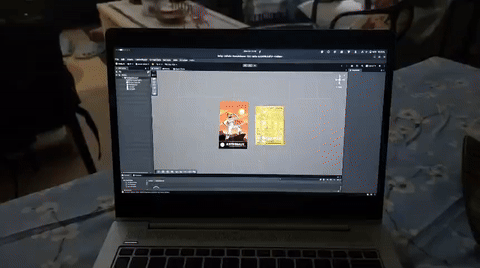
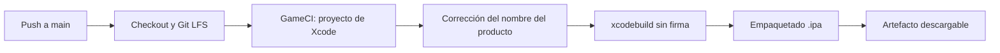

# Práctica 6: Realidad Aumentada con Unity y Vuforia

Interfaces Multimodales · Grado en Ingeniería Informática · Universidad de La Laguna · Curso 2025-2026

Aplicación de realidad aumentada para iOS que reconoce dos imágenes y muestra un modelo 3D distinto sobre cada una.

## Demostración

[](video_demostracion.mp4)

Haz clic en la animación para ver el [vídeo completo](video_demostracion.mp4). El vídeo es una grabación de pantalla de un iPhone: la app detecta cada imagen, muestra su modelo 3D y lo oculta cuando la imagen sale del encuadre.

## Qué hace la app

| Imagen objetivo | Modelo 3D asociado |
| --- | --- |
| Astronaut | Stylized Astronaut |
| Pokemon | Fantasy Bee (amusedART) |

Cada modelo es hijo de su `ImageTarget` en la jerarquía. El `DefaultObserverEventHandler` de Vuforia lo activa solo mientras la imagen se está rastreando.

## Tecnologías

- Unity 6 (6000.6.6f1)
- Vuforia Engine 11.4.4
- iOS como plataforma de destino
- GitHub Actions y GameCI para la compilación

## Configuración del proyecto

- Se elimina la `Main Camera` y se usa la `ARCamera` de Vuforia, con la clave de licencia configurada en `VuforiaConfiguration`.
- La base de datos de objetivos (`vuforia_unity_practica_06`) se genera en el Target Manager de Vuforia, se importa al proyecto y se activa en la configuración.
- La escena tiene dos `ImageTarget` (`carta01` y `carta02`), cada uno enlazado a una imagen de la base de datos.
- Ajustes de iOS: `Camera Usage Description` con el texto *"Camera access required for target detection and tracking"* y `Render Over Native UI` activado.

## Compilación automática

El workflow `.github/workflows/build-ios.yml` genera un `.ipa` sin firmar en cada push a `main`. Así no hace falta un Mac propio ni una cuenta de desarrollador de Apple de pago.



Puntos a tener en cuenta:

- **Runner:** `macos-latest`, porque Xcode solo existe en macOS.
- **Licencia de Unity:** se pasa a GameCI mediante secrets del repositorio (`UNITY_LICENSE`, `UNITY_EMAIL`, `UNITY_PASSWORD`).
- **Nombre del producto:** en macOS el sistema de archivos no distingue mayúsculas, y la carpeta `Vuforia` del SDK chocaba con el ejecutable. El workflow usa `perl` para renombrar el producto a `AR_Practica6` en `project.pbxproj` antes del enlazado.
- **Empaquetado:** se copia el `.app` a una carpeta `Payload/` y se comprime como `AR_Practica6.ipa`.

## Instalar en un iPhone

1. En la pestaña **Actions** de GitHub, abre la última ejecución correcta y descarga el artefacto `AR_Practica6_iOS_Unsigned`.
2. Descomprímelo para obtener `AR_Practica6.ipa`.
3. Conecta el iPhone por USB, abre Sideloadly (o AltStore) y arrastra el `.ipa`.
4. Introduce tu Apple ID para la firma local y pulsa **Start**.
5. En el iPhone, confía en el perfil en *Ajustes > General > VPN y gestión de dispositivos*.

Con un Apple ID gratuito la app caduca a los 7 días y hay que reinstalarla.

## Estructura del repositorio

```
.
├── .github/workflows/build-ios.yml   Workflow de compilación
├── Assets/
│   ├── Images/                       Imágenes usadas como objetivos
│   ├── Resources/                    VuforiaConfiguration
│   ├── Scenes/                       Escena principal
│   ├── StreamingAssets/              Base de datos de objetivos
│   ├── Stylized_Astronaut/           Modelo 3D
│   └── amusedART/                    Modelo 3D (Fantasy Bee)
├── Packages/                         Incluye el paquete de Vuforia (Git LFS)
├── ProjectSettings/
├── video_demostracion.mp4
├── video_demostracion.gif
└── README.md
```

## Notas

- El paquete de Vuforia (`com.ptc.vuforia.engine-11.4.4.tgz`, unos 130 MB) está en Git LFS. Antes de clonar hay que tener instalado `git-lfs`, o ejecutar `git lfs pull` después.
- El Play Mode de Vuforia no funciona en Linux, que es donde se desarrolló el proyecto. Las pruebas se hicieron directamente en el dispositivo.
